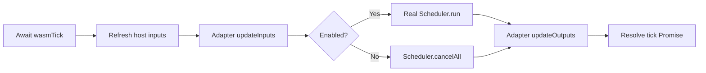

# WPILib WASM library

`org.teamvan.wpilib-wasm` is a standalone Gradle plugin and source-bundled runtime for FRC WPILib Commands V3 projects. It owns the Web Image build, WPILib/vendor shadows, JavaScript Promise Integration (JSPI), browser driver station, and native smoke suite. It has no dependency on VAR27's drivetrain, generated constants, `Manager`, or robot entry point.

The plugin JAR contains the runtime Java sources, reflection metadata, frontend, tools, and smoke sources. Each consuming robot compiles those sources against **its own** WPILib dependency classpath. You do not copy a WASM build script, runtime sources, or smoke tests into each robot.

## Requirements and compatibility

- Gradle 9.4.1 and Java 25 are the configuration used here.
- A GraalVM JDK that includes Web Image: `native-image --tool:svm-wasm` and `org.graalvm.webimage.api` must be available. A regular Java 25 installation is insufficient.
- Binaryen tools on `PATH`.
- A native compiler supported by GraalVM. On Windows, use a **VS Code x64 developer terminal**, not the default x86 developer environment.
- Bun, or another JavaScript runtime providing `WebAssembly.Suspending` and `WebAssembly.promising`, for CLI smokes. The browser needs the same JSPI APIs.
- WPILib 2027 alpha-7 and its Commands V3 vendordep are the supported baseline. Keep the normal `wpi.java.deps.wpilib()` and `wpi.java.vendor.java()` dependencies in the consumer. Commands V2 and V3 cannot coexist.

The build is reusable across robot architectures; it does not automatically emulate every HAL or vendor JNI API. Choose simulated IO in your adapter and supply any additional shadows needed by your project. Other WPILib versions may change the shadowed APIs and require corresponding runtime updates.

### Select the GraalVM JDK on Windows

In the x64 developer terminal, for the Downloads installation used by this repository:

```powershell
$env:JAVA_HOME = Join-Path $env:USERPROFILE 'Downloads\graalvm-25.4.4.1.1+1.1'
$env:GRAALVM_HOME = $env:JAVA_HOME
$env:Path = "$env:JAVA_HOME\bin;$env:Path"
java -version
$env:VSCMD_ARG_HOST_ARCH
$env:VSCMD_ARG_TGT_ARCH
```

Both architecture variables should say `x64`. Adjust the JDK directory if you installed a different Web Image distribution. A conflicting `org.gradle.java.home` or toolchain configuration must not select a different compiler JDK for the WASM source sets.

## 1. Make the plugin available

Choose one installation method.

### Included source build

Place this directory at `wpilib-wasm/` inside the robot project, or use an equivalent relative path. Add this statement **inside the existing `pluginManagement` block** in the robot's `settings.gradle`:

```groovy
includeBuild('wpilib-wasm')
```

Keep the generated WPILib repository configuration. Add this entry to the robot's existing `plugins` block in `build.gradle`:

```groovy
id 'org.teamvan.wpilib-wasm'
```

The included build automatically rebuilds the plugin and its bundled sources/assets after library changes. This is how VAR27 consumes the library.

### Published library

From this repository's root, build and publish the standalone plugin locally:

```sh
./gradlew -p wpilib-wasm check assemble publishToMavenLocal
```

With a separate checkout and an installed compatible Gradle, the equivalent command from this directory is `gradle check assemble publishToMavenLocal`.

Ensure the consumer's existing `pluginManagement.repositories` includes `mavenLocal()`. Then use the versioned plugin entry:

```groovy
id 'org.teamvan.wpilib-wasm' version '0.1.0'
```

The implementation artifact is `org.teamvan.wpilibwasm:wpilib-wasm:0.1.0`; Gradle resolves it through the `org.teamvan.wpilib-wasm` plugin marker. The supplied [independent counter example](examples/commands-v3) consumes this published artifact, not an included source build. For a team Maven server, publish the same plugin publications to that repository and add it to the consumer's plugin repositories.

Do not add the runtime to desktop `implementation` dependencies. The plugin adds it only to the WASM build.

## 2. Configure the robot's WASM entry point

Keep the robot's existing Java, GradleRIO, deployment, and desktop simulation configuration. Add:

```groovy
wpilibWasm {
    mainClass.set('example.ExampleWasm')
    imageName.set('counter')
}
```

Use your adapter's actual fully qualified name. The example values above correspond to the complete example project in this library.

| Property | Default | Meaning |
|---|---|---|
| `mainClass` | Required | Static Java entry point that calls `WasmApplication.launch(...)`. |
| `imageName` | `wasm` | Native artifact basename, without extensions. |
| `javascriptRuntime` | `bun` | JSPI-capable executable on `PATH`, or an absolute executable path. |
| `verifyDrive` | `false` | Enable the production runner's additional Pose/keyboard-drive acceptance scenarios. |

The plugin applies GraalVM's native-build plugin itself. Remove the old robot-local WASM source-set definitions, native binary configuration, JSPI loader patch, and duplicated library sources when migrating. Do not keep old-package compatibility aliases.

## 3. Implement a robot adapter

Put WASM-only application code in `src/wasm/java/`. Implement `org.teamvan.wasm.WasmRobot` and export it through `WasmApplication.launch(Supplier<? extends WasmRobot>)`.

The [complete example adapter](examples/commands-v3/src/wasm/java/example/ExampleWasm.java) is:

```java
package example;

import org.teamvan.wasm.WasmApplication;
import org.teamvan.wasm.WasmRobot;
import org.teamvan.wasm.WasmRuntime;
import org.wpilib.telemetry.Telemetry;

public final class ExampleWasm implements WasmRobot {
  private final Counter counter = new Counter();
  private boolean enabled;

  public static void main(String... args) {
    WasmApplication.launch(ExampleWasm::new);
  }

  @Override
  public void updateInputs() {
    enabled = WasmRuntime.isEnabled();
  }

  @Override
  public void updateOutputs() {
    Telemetry.log("Example/Counter", counter.ticks());
    Telemetry.log("Example/Enabled", enabled);
  }
}
```

Its [Counter mechanism](examples/commands-v3/src/main/java/example/Counter.java) installs a real Commands V3 default command. In another robot, construct your existing mechanisms with their simulated IO implementations, set their default commands/bindings, and delegate the two lifecycle methods to your normal input/output routines. VAR27's [adapter](../src/wasm/java/org/teamvan/robot/WasmMain.java) demonstrates this with its real drivetrain and manager.

Do not construct a JNI-backed `Robot` just to reuse its periodic method, and do not call `RobotBase.startRobot`. Avoid hardware/JNI initialization in static fields of classes reachable from the adapter. Do not run a second scheduler inside the adapter; the library owns that part of the cycle:



`wasmStart()` constructs the adapter once, after telemetry installation and the initial driver-station refresh. `Scheduler` and `Coroutine` are unchanged WPILib dependencies; only their underlying continuation implementation is replaced by the library's JSPI-backed shadows.

## 4. Build, smoke, and serve

Run these commands from the consuming robot project:

```sh
./gradlew nativeCompile
./gradlew wasmRun
./gradlew wasmSmoke
./gradlew wasmSite
python -m http.server 8099 --directory build/wasm/site
```

Open `http://localhost:8099/sim/`. On Windows, `./gradlew` can be replaced with `.\gradlew.bat`.

| Task | Result |
|---|---|
| `nativeCompile` | `build/native/nativeCompile/<imageName>.js` and `<imageName>.js.wasm`. |
| `wasmRun` | Builds and runs the consumer image; reports telemetry count and tick latency. |
| `nativeSmokeCompile` | Builds the library's generic native behavioral test image. |
| `wasmSmoke` | Runs real native dynamics, telemetry serialization, lifecycle, continuation, cancellation, child-awaiting, exception identity, and overlap-rejection checks. |
| `wasmSite` | Stages a complete browser frontend under `build/wasm/site/sim/`. |

The staged frontend always uses canonical `wasm.js` and `wasm.js.wasm` filenames, even when `imageName` is `counter`. Serve the staged directory over HTTP; do not open the HTML directly with `file://`.

For the independent published-library example, from this repository's root:

```sh
./gradlew -p wpilib-wasm publishToMavenLocal
./gradlew -p wpilib-wasm/examples/commands-v3 wasmRun wasmSmoke wasmSite
python -m http.server 8099 --directory wpilib-wasm/examples/commands-v3/build/wasm/site
```

That example has no drivetrain or CTRE dependency, uses a different Java package and image name, and advances `/Example/Counter` through a real scheduler default command. Its default browser page still shows the standard Pose widget; a non-drive project can supply a different UI for its own telemetry.

For a robot publishing the standard Pose topics and compatible field-relative drive controls, enable the stronger drive acceptance scenarios with `verifyDrive.set(true)`. They check disabled startup, forward/lateral movement, alliance reversal, rotation, disable/settle, and re-enable. This is enabled for VAR27, not for arbitrary non-drive projects.

The low-level tools are included in `build/wasm/library/tools/wasm-debug/` after preparation:

```text
run-wasm.mjs [buildDir] [imageName] [--drive]
run-smoke.mjs [buildDir] [imageName]
run-browser.mjs [pageUrl] [debugPort]
```

Invoke them with the configured JSPI-capable Node/Bun executable. Defaults are relative to the consumer's current working directory, not the library's checkout. Prefer the Gradle tasks so artifact paths and image names stay synchronized.

## Browser and telemetry contract

Install `createWasmContinuations()` from `sim/continuations.js` as `globalThis.wasmContinuations` **before** `GraalVM.run()`. Install the following functions before `wasmStart()`:

| Host function | Contract |
|---|---|
| `wasmNowNanos()` | Monotonic simulated time in nanoseconds. |
| `wasmDs()` | `{enabled, alliance, leftX, leftY, rightX}`; alliance is `"red"` or `"blue"`, axes are in `[-1, 1]`. |
| `wasmNtGet(path)` | Current host telemetry value, or `undefined`. |
| `wasmNtPut(path, value)` | Receives an ordinary JavaScript telemetry value. |

Advance simulated time by 20 ms between ticks and **await every `wasmTick()` Promise before starting another tick**. The default browser driver station handles this, displays startup/runtime errors, and uses WASD for translation, Q/E for rotation, and Shift for red alliance. JSPI does not require `SharedArrayBuffer` or cross-origin isolation.

The existing serialization protocol is unchanged: primitive scalars and arrays are native JS values; raw bytes, little-endian structs, and protobuf wire bytes are lowercase hex strings. Longs outside the JS safe-integer range are exact decimal strings, including inside arrays. Timestamps and topic metadata are not transported.

The stock Pose widget reads these optional numeric topics, which the robot adapter—not the library—publishes:

| Topic | Units |
|---|---|
| `/Sim/Pose/X` | Meters |
| `/Sim/Pose/Y` | Meters |
| `/Sim/Pose/Rotation` | Radians |

## Source isolation and extending support

The plugin creates three isolated source sets:

- `wasmRuntime`: the bundled library sources/resources, compiled against `main.compileClasspath` without depending on the robot's classes.
- `wasm`: the consumer's `src/wasm/java/`, compiled against the runtime and normal robot code.
- `wasmTest`: the bundled native smoke sources.

At native-image build time the consumer's WASM output wins over bundled runtime shadows, which win over desktop/vendor classes. None of those shadows are added to desktop `main` or the robot JAR's compiled packages. The plugin also supplies `-parameters` and `-XDstringConcat=inline` to Java compilation for Web Image compatibility, including reachable normal robot classes.

The supplied shadows cover the current driver station's three axes and enabled/alliance state, clocks/battery, alert/runtime-loader/RobotBase entry points, DC-motor simulation, matrix exponential, and the lightweight Phoenix `CANBus` API. They are not full replacements for every WPILib or vendor class. Add matching consumer-specific replacements under `src/wasm/java/<original/package>/` for additional native APIs, or use pure Java simulation IO. A replacement must implement the APIs your reachable robot code uses; don't silently substitute hardware no-ops.

For additional native-image reflection/resources, use the consuming WASM source set's `src/wasm/resources/META-INF/native-image/` directory. Keep your normal deployment entry point and real IO implementations separate.

## Upgrading and troubleshooting

- **`org.graalvm.webimage.api` is missing:** the Java compiler is not using the Web Image JDK. Check `JAVA_HOME`, `GRAALVM_HOME`, `PATH`, and Gradle's selected JVM/toolchain.
- **Windows compiler or architecture failure:** use the x64 developer environment and verify both `VSCMD_ARG_*_ARCH` values.
- **JSPI unavailable:** select a runtime/browser exposing `WebAssembly.Suspending` and `WebAssembly.promising`; the host reports an explicit startup error rather than faking continuations.
- **JNI or native symbol error:** a reachable hardware/vendor class still needs simulated IO or a matching WASM shadow.
- **Main class unset:** configure `wpilibWasm.mainClass`; a desktop `Main` that starts HAL is not the WASM adapter.
- **GraalVM loader hook/metadata error:** re-check the generated instantiate hook, `conversion.unproxy()`/throwable conversion, and the application/continuation metadata exports. The library deliberately fails instead of accepting an incompatible loader.

After changes to GraalVM, WPILib, shadows, source-bundle packaging, or browser interop, run both `wasmRun` and `wasmSmoke`, then exercise the staged page with actual input. Update the working example when changing the integration API.

Retained WPILib-derived code is accompanied by [WPILib-License.md](WPILib-License.md); that notice is also included in the distributed bundle's `licenses/` directory.
